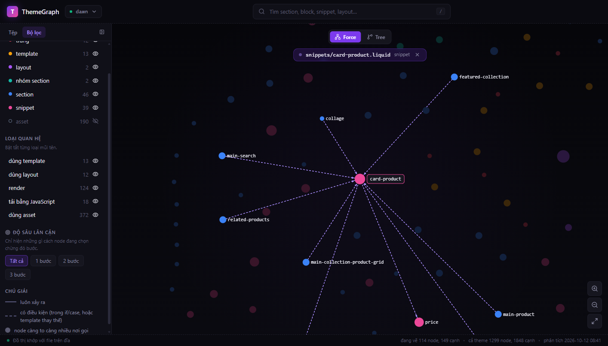
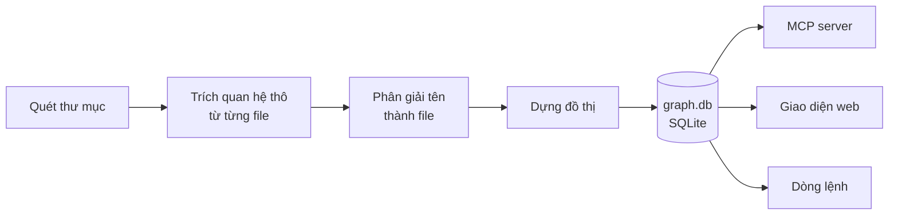
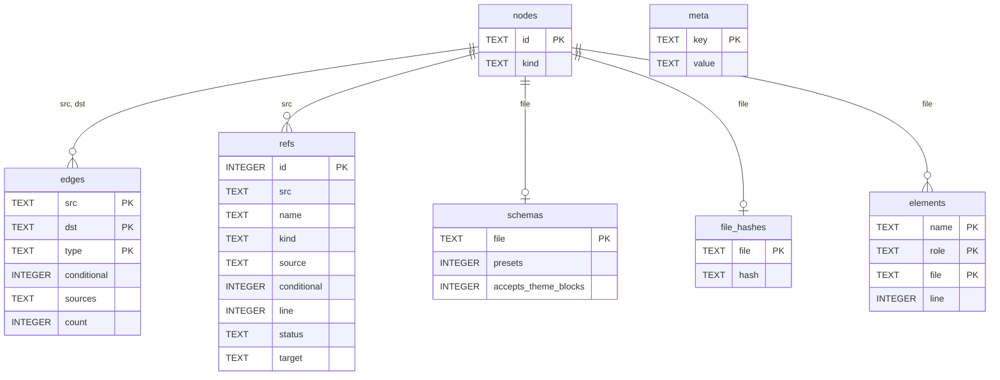

# ThemeGraph

**Đồ thị tri thức cho Shopify theme.** ThemeGraph đọc mã nguồn của một theme (Liquid, JSON, JavaScript) và dựng thành một đồ thị: file nào render file nào, trang nào dùng file nào, file nào đọc setting và khoá dịch nào. Đồ thị đó được đưa cho AI agent qua MCP và vẽ ra trên một giao diện web.

*ThemeGraph indexes a Shopify Liquid theme into a knowledge graph and exposes it to AI agents through MCP tools and to people through a web graph explorer. This README is in Vietnamese.*



## Bắt đầu nhanh

Cần Node.js 22.13 trở lên. Chạy được trên Windows, macOS và Linux.

```sh
# 0. Cài (một lần)
npm install -g https://github.com/nndh2k4/themegraph/releases/latest/download/themegraph.tgz

# 1. Phân tích theme: đứng trong thư mục có sections/, snippets/, templates/
themegraph analyze

# 2. Nối với AI agent (một lần, tự nhận Claude Code và Cursor)
themegraph setup

# 3. Mở giao diện đồ thị ở http://localhost:7777
themegraph serve
```

- **`analyze`** đọc mọi file của theme và ghi đồ thị vào `.themegraph/graph.db` ngay trong thư mục theme. Nó không sửa file nào của theme; thư mục `.themegraph/` tự kèm một `.gitignore` nên không lọt vào commit. Sửa theme xong thì chạy lại.
- **`setup`** đăng ký ThemeGraph làm MCP server cho Claude Code và Cursor, và cài một skill dặn Claude Code khi nào nên dùng nó. Thêm `--dry-run` để chỉ xem nó sẽ ghi gì, `--remove` để gỡ.
- **`serve`** mở giao diện web cho mọi theme đã phân tích trên máy. Thêm `--port <n>` để đổi cổng.

<details>
<summary><strong>Cài không được?</strong> máy không ra mạng · npm hiểu nhầm tên file</summary>

Tải file `themegraph.tgz` ở trang [Releases](https://github.com/nndh2k4/themegraph/releases) rồi cài từ file. Phải có `./` ở đầu, không thì npm hiểu đó là tên một repo trên GitHub:

```sh
npm install -g ./themegraph.tgz
```

Gói cài tự chứa mọi thứ (kể cả giao diện web), không tải thêm phụ thuộc nào và không cần trình biên dịch C++.

</details>

## Vì sao cần một đồ thị

Một trang của Shopify theme được dựng qua nhiều tầng: loại trang → template JSON → section → block → snippet → asset. Mã không có lệnh `import`: `` chỉ nêu một cái tên, còn file nào được gọi là do quy ước thư mục quyết định.

Vì vậy câu hỏi "sửa `snippets/price.liquid` thì trang nào đổi?" không trả lời được bằng một lần `grep`. `grep` cho ra các file gọi trực tiếp; từ đó phải tìm tiếp ai gọi các file ấy, lặp lại tới khi gặp template. AI agent làm việc này bằng tay thì tốn nhiều lượt gọi công cụ và hay dừng sớm, nên trả lời thiếu.

ThemeGraph làm việc đó một lần, lúc phân tích, rồi trả lời từ đồ thị: mỗi câu hỏi là một phép duyệt, kết quả đầy đủ trong một lần gọi.

## AI agent nhận được gì

Sau `themegraph setup`, trong một thư mục theme đã `analyze`, cứ hỏi agent bằng lời thường:

> Tôi định sửa `snippets/price.liquid`. Những trang nào bị ảnh hưởng?

Agent có sáu tool MCP:

| Tool | Trả lời câu hỏi |
| --- | --- |
| `impact` | Sửa hoặc xoá file này thì file nào, trang nào bị ảnh hưởng, qua đường nào |
| `render_flow` | Một trang (product, collection, cart...) render những file nào, lồng nhau ra sao |
| `context` | File này là gì, ai gọi nó, nó gọi ai, đọc setting và khoá dịch nào |
| `search` | Tìm file, trang, khoá dịch, setting theo tên |
| `dead_code` | File, khoá dịch và setting nào không còn được dùng |
| `list_themes` | Các theme đã phân tích trên máy |

Server chỉ đọc: nó không sửa theme và không tự phân tích lại. Khi file trên đĩa đã khác lúc phân tích, mỗi câu trả lời kèm một cảnh báo để agent biết cần chạy lại `themegraph analyze`.

## Giao diện web

`themegraph serve` rồi mở `http://localhost:7777`:

- **Đồ thị** vẽ bằng WebGL. Bấm một node thì những file nối trực tiếp với nó sáng lên, phần còn lại mờ đi. Mũi tên nét đứt là quan hệ có điều kiện (nằm trong ``, vòng lặp, hoặc ở một template thay thế).
- **Tìm kiếm**: gõ `/` rồi gõ tên section, block, snippet, layout; Enter để đưa camera tới node đó.
- **Panel trái**: cây file của theme, và bộ lọc theo loại node, loại quan hệ, độ sâu lân cận quanh node đang chọn (1 tới 3 bước).
- **Hai bố cục**: Force (các cụm tự tách theo quan hệ) và Tree (xếp theo tầng: trang ở trên, asset ở dưới).
- Mọi trạng thái nằm trong địa chỉ trang, nên nút Back hoạt động và chép đường dẫn là chép đúng cái đang xem.

Server chỉ nghe trên `localhost`, và API của nó không trả nội dung file của theme.

## Cách hoạt động



1. **Quét.** Đi qua thư mục theme, xếp mỗi file vào một loại theo thư mục chứa nó (`sections/` → section, `snippets/` → snippet...). File nằm ngoài quy ước của Shopify bị bỏ qua và được liệt kê ra.
2. **Trích quan hệ thô.** Mỗi loại file có một bộ đọc riêng:
   - *Liquid*: phân tích thành cây cú pháp, lấy `render`, `include`, `section`, `sections`, `content_for`, filter `asset_url` và `t`, các lần đọc `settings.x` / `section.settings.x` / `block.settings.x`, khối ``, và import map trong `<script type="importmap">`. Tên ghép từ chữ viết sẵn trong cùng file (`assign`, `split`, `append`, vòng `for` trên một danh sách hay một khoảng số) được tính ra, ví dụ `'slide-' | append: i | asset_url` với `i` chạy từ 1 tới 3.
   - *JSON*: template và section group cho biết section và block nào được xếp vào trang; `config/settings_schema.json` cho các setting toàn cục; file locale mặc định cho các khoá dịch.
   - *JavaScript*: không phân tích cú pháp, chỉ dò vài cách viết quen thuộc: `import` tĩnh và động, section được tải qua Section Rendering API (tên viết sẵn, hoặc một biến được gán chữ viết sẵn trong cùng file), và `customElements.define("tên")`.
3. **Phân giải.** Đổi mỗi cái tên thành một file theo quy ước: `render 'x'` là `snippets/x.liquid`, `section 'x'` là `sections/x.liquid`. Tên không ứng với file nào thành một *tham chiếu hỏng*, được ghi lại kèm file và số dòng.
4. **Dựng đồ thị.** Gộp các lời gọi trùng thành cạnh, thêm node loại trang suy từ tên template (`templates/product.alt.json` thuộc trang `product`), thêm cạnh suy từ quy ước (template không nêu layout thì dùng `layout/theme.liquid`).
5. **Ghi.** Toàn bộ đồ thị vào một file SQLite, thay hẳn bản cũ.

Ba lớp vỏ (dòng lệnh, MCP server, API cho giao diện) đều gọi vào cùng một gói lõi; không lớp nào tự đọc Liquid.

## Thuật toán và lý do chọn

### 1. Trích quan hệ: phân tích cú pháp thay vì tìm chuỗi

ThemeGraph dùng parser chính thức của Shopify (`@shopify/liquid-html-parser`) để có cây cú pháp của từng file, rồi duyệt cây hai lượt: lượt đầu ghi lại nút cha của mỗi nút, lượt sau lấy quan hệ. Với mỗi lời gọi, công cụ leo ngược lên các nút cha; gặp `if`, `unless`, `case`, `for` hoặc `tablerow` thì lời gọi đó là *có điều kiện*.

| | Tìm chuỗi (regex) | Cây cú pháp (đã chọn) | Chạy thật theme |
| --- | --- | --- | --- |
| Lời gọi nằm trong `` | Tính nhầm | Bỏ qua đúng | Bỏ qua đúng |
| Biết lời gọi có điều kiện | Không | Có | Chỉ thấy nhánh đang chạy |
| Tên ghép lúc chạy (`'icon-' \| append: x`) | Không | Không | Có, với dữ liệu đang thử |
| Cần cửa hàng và dữ liệu thật | Không | Không | Có |
| Thấy mọi nhánh của mã | Có | Có | Không |

Chạy thật cho kết quả đúng nhất nhưng chỉ với đúng một bộ dữ liệu, và cần một cửa hàng; công cụ chạy trên máy lập trình viên và trong CI thì không có thứ đó. Tìm chuỗi thì đơn giản nhưng sai ở chú thích và không biết điều kiện. Cây cú pháp nằm giữa: thấy mọi nhánh, đúng với chú thích, và chạy ở đâu cũng được.

Parser được gọi ở chế độ chỉ phân tích phần Liquid, coi HTML là văn bản thường. Nhờ vậy một file có HTML viết sai (thẻ không đóng) vẫn đọc được, vì mọi quan hệ cần lấy đều nằm trong tag Liquid.

**Nhược điểm:** phân tích tĩnh không thấy tên ghép lúc chạy. Riêng JavaScript không được phân tích cú pháp mà chỉ dò mẫu, nên quan hệ lấy từ JavaScript là một phần của sự thật, không phải toàn bộ (xem [Giới hạn](#giới-hạn-đã-biết)).

### 2. Dựng đồ thị: hàm thuần, kết quả xác định

Bước dựng đồ thị không đọc đĩa và không phụ thuộc thứ tự đầu vào: cùng một tập file luôn cho ra đúng một đồ thị, node và cạnh đã sắp xếp. Nhờ vậy hai lần phân tích cùng một theme cho cùng một đồ thị (chỉ khác thời điểm ghi), và test so sánh được kết quả một cách chính xác.

Nhiều lời gọi giữa cùng hai file được gộp thành **một cạnh** kèm số lần gọi. Cạnh chỉ mang nhãn *có điều kiện* khi **mọi** lời gọi gộp vào nó đều có điều kiện: chỉ cần một lời gọi vô điều kiện là file đích chắc chắn được dùng. Từng lời gọi riêng lẻ (có số dòng) vẫn được giữ ở một bảng khác, để trả lời câu "gọi ở dòng nào".

Mỗi lần `analyze` dựng lại **toàn bộ** đồ thị, không cập nhật từng phần. Lý do: phân tích cả theme mất 0,5 tới 1,6 giây trên ba theme đã đo, trong khi cập nhật từng phần phải xử lý đúng việc một file đổi làm đổi cách phân giải của file khác (thêm `snippets/x.liquid` biến một tham chiếu hỏng ở nơi khác thành cạnh). Cái giá là theme lớn hơn nhiều lần sẽ thấy chậm.

### 3. Duyệt đồ thị: truy vấn đệ quy của SQLite

Ba câu hỏi chính đều là bài toán *tập node tới được*:

- **Ảnh hưởng** (`impact`): từ một file, đi **ngược** chiều mũi tên lên tới loại trang.
- **Luồng render** (`render_flow`): từ một trang, đi **xuôi** xuống mọi file nó kéo theo.
- **Mã chết** (`dead_code`): đánh dấu mọi thứ tới được từ các điểm vào; phần còn lại là không dùng.

Phép duyệt là một câu `WITH RECURSIVE` gồm ba bảng tạm, cùng xuất phát từ một node:

```sql
WITH RECURSIVE
  reach(id) AS (                 -- tập node tới được
    SELECT ?1
    UNION
    SELECT e.src FROM edges e JOIN reach r ON e.dst = r.id
  ),
  walk(id, depth) AS (           -- node kèm độ sâu, chặn ở ?2
    SELECT ?1, 0
    UNION
    SELECT e.src, w.depth + 1 FROM edges e JOIN walk w ON e.dst = w.id
    WHERE w.depth + 1 < ?2
  ),
  sure(id) AS (                  -- tới được chỉ qua cạnh vô điều kiện
    SELECT ?1
    UNION
    SELECT e.src FROM edges e JOIN sure s ON e.dst = s.id
    WHERE e.conditional = 0
  )
SELECT w.id, min(w.depth) AS depth, w.id IN (SELECT id FROM sure) AS certain
FROM walk w GROUP BY w.id;
```

- `reach` dùng `UNION` (không phải `UNION ALL`), nên một node đã có thì không được thêm lần nữa: truy vấn tự dừng cả khi đồ thị có vòng.
- `walk` cho **độ sâu ngắn nhất** tới mỗi node. Ở đây `UNION` không cứu được: đi quanh một vòng sinh ra `(a, 0)`, `(a, 2)`, `(a, 4)`... là các dòng khác nhau. Vì vậy độ sâu bị chặn, bắt đầu ở 16. Nếu số node trong `walk` ít hơn trong `reach`, tức còn node nằm xa hơn mức chặn, thì nhân đôi mức chặn và chạy lại. Theme sâu nhất từng đo là 7 tầng, nên vòng nhân đôi gần như không bao giờ chạy.
- `sure` cho biết quan hệ **luôn xảy ra** hay chỉ **có thể xảy ra**: một node là chắc chắn khi có ít nhất một đường tới nó mà mọi cạnh đều vô điều kiện.

**Vì sao không dùng cơ sở dữ liệu đồ thị** (Neo4j, hay LadybugDB như GitNexus)? Đồ thị của một theme nhỏ: 1 300 tới 3 800 node, 1 800 tới 5 500 cạnh trên ba theme đã đo. Ở cỡ đó phần duyệt bằng truy vấn đệ quy chỉ mất cỡ mili giây (một phép duyệt ngược trên Dawn đo được dưới 1 ms), còn `node:sqlite` có sẵn trong Node.js nên gói cài không kéo theo thư viện native nào, không cần trình biên dịch, và chỉ nặng 393 KB. Cơ sở dữ liệu đồ thị mạnh hơn ở truy vấn theo mẫu nhiều bước và ở đồ thị hàng triệu cạnh, là thứ bài toán này không cần.

**Vì sao không nạp cả đồ thị vào bộ nhớ rồi duyệt theo chiều rộng (BFS) bằng JavaScript?** Cách đó cũng đúng, và ThemeGraph có cài nó, nhưng dùng làm **phép kiểm chứng**: lệnh `themegraph verify` chạy cả hai cách từ mọi node theo cả hai chiều rồi so từng kết quả. Hai cách viết khác hẳn nhau mà ra cùng kết quả thì mới tin được cả hai. Trên ba theme đã đo, số chỗ sai khác là 0. Truy vấn SQL được chọn làm đường chính vì mỗi câu hỏi chỉ đọc phần đồ thị nó cần, và vì chính file `graph.db` trở thành thứ ai cũng tự truy vấn được bằng `sqlite3`.

**Nhược điểm của cách này:**

- Trên đồ thị có vòng, mỗi tầng `walk` được phép đi thêm lại sinh thêm dòng cho mọi node nằm sau vòng, nên mức chặn độ sâu phải giữ thấp. Chặn ở "số node tới được" vẫn đúng nhưng chậm gấp hàng chục lần trên theme lớn.
- Truy vấn chỉ trả về tập node và độ sâu, không trả về đường đi. Để nói "trang này dính qua file nào", `impact` phải duyệt xuôi thêm một lần từ mỗi trang bị ảnh hưởng. Một câu `impact` vì thế là nhiều truy vấn chứ không phải một.
- Tên loại cạnh được ghép vào chuỗi SQL. Điều này chỉ an toàn vì chúng là hằng số của chương trình, không bao giờ là chữ người dùng gõ.

### 4. Mã chết: đánh dấu từ điểm vào, kèm mức tin cậy

Cùng ý tưởng với bước đánh dấu của bộ thu gom rác: thứ gì không tới được từ một *điểm vào* thì không còn dùng. Có ba loại điểm vào: loại trang; section có preset (merchant thêm được từ theme editor dù chưa template nào dùng); và theme block công khai, khi có một file đang dùng nhận `@theme`.

Kết quả không phải một danh sách "xoá được" duy nhất mà chia theo mức tin cậy, vì phân tích tĩnh có điểm mù:

- **Chắc chắn**: snippet, block, section group. Chúng chỉ dùng được qua lời gọi có tên viết sẵn, thứ đồ thị ghi lại đủ.
- **Cần xem lại**: section, asset, layout không ai gọi, cùng mọi thứ nằm dưới chúng. Ba loại này còn cách dùng công cụ không thấy (JavaScript tải section bằng tên là biến, tên asset ghép lúc chạy).
- **Dùng thẻ mà không nạp file**: file JavaScript định nghĩa một custom element mà theme đang viết ra, nhưng không thẻ `<script>` nào nạp nó. Đây không phải mã chết mà là lỗi của theme; cách chữa là nạp file, không phải xoá.

**Ưu điểm:** không khẳng định quá điều công cụ biết. **Nhược điểm:** nhóm "cần xem lại" có thể dài (46 file trên Dawn, phần lớn là asset) và vẫn cần người kiểm.

### 5. Bố cục đồ thị trên giao diện

- **Force** dùng ForceAtlas2 (thư viện Graphology), chạy 300 vòng trước khi vẽ. Thuật toán này kéo các node có cạnh nối lại gần nhau và đẩy các node khác ra xa, nên các cụm file liên quan tự tách ra mà không cần biết trước cấu trúc. Nhược điểm: vị trí không mang nghĩa, và đồ thị đầy đủ của một theme lớn vẫn rối, phải lọc hoặc chọn một node.
- **Tree** xếp node theo tầng cố định của Shopify: trang → template → layout và section group → section → block → snippet → asset; tầng đông hơn 32 node thì xuống hàng. Cách này không cần tính toán, luôn ra cùng một hình, và đọc được ngay theo chiều dựng trang. Nhược điểm: tầng do **loại** node quyết định chứ không phải do cạnh, và không có bước giảm cạnh cắt nhau như các thuật toán vẽ đồ thị phân tầng đầy đủ, nên snippet gọi snippet nằm cùng một tầng.

Vẽ bằng Sigma.js (WebGL), để vài nghìn node vẫn kéo và phóng to được.

## Cấu trúc của `graph.db`

Mỗi theme có một file `<theme>/.themegraph/graph.db`, là một cơ sở dữ liệu SQLite bảy bảng. Mở được bằng bất kỳ công cụ SQLite nào.



| Bảng | Mỗi dòng là | Dùng để |
| --- | --- | --- |
| `nodes` | Một node: `id` và `kind` | Danh sách mọi thứ trong đồ thị |
| `edges` | Một quan hệ đã gộp giữa hai node, theo loại | Mọi phép duyệt |
| `refs` | **Một lời gọi** trong mã, có số dòng, kể cả lời gọi hỏng | "Gọi ở dòng nào", danh sách tham chiếu hỏng |
| `schemas` | Dữ kiện từ `` của một section hoặc block | Điểm vào của phép tìm mã chết |
| `file_hashes` | SHA-1 nội dung của một file đã đọc | Biết đồ thị còn khớp với đĩa hay không |
| `elements` | Một custom element: file nào định nghĩa, file nào dùng | Tìm file JavaScript dùng mà không nạp |
| `meta` | `schema_version`, `tool_version`, `analyzed_at` | Biết file do phiên bản nào ghi, lúc nào |

**Node.** `id` là chuỗi đọc được, tự nói lên nó là gì:

| Loại (`kind`) | Ví dụ `id` |
| --- | --- |
| `page_type` | `page:product`, `page:customers/login` |
| `template`, `layout`, `section`, `section_group`, `block`, `snippet`, `asset`, `locale`, `locale_schema`, `config` | Đường dẫn tính từ gốc theme: `snippets/price.liquid` |
| `translation_key` | `t:general.cart.title` |
| `setting` | `setting:settings.cart_type`, `setting:sections/header.liquid#section.logo` |

**Cạnh.** Bảy loại:

| `type` | Từ → tới | Nghĩa |
| --- | --- | --- |
| `USES_TEMPLATE` | loại trang → template | Trang này dùng template này |
| `USES_LAYOUT` | template → layout | Template nằm trong layout này |
| `RENDERS` | file → file | `render`, `include`, `section`, `sections`, block; hoặc JSON xếp section vào trang |
| `USES_ASSET` | file → asset | Qua filter `asset_url`, `asset_img_url`, `inline_asset_content`; hoặc JavaScript `import` một file khác trong `assets/` (theo import map hay đường dẫn tương đối) |
| `LOADS_SECTION` | file → section | JavaScript tải riêng section này lúc chạy |
| `USES_TRANSLATION` | file → khoá dịch | Qua filter `t` |
| `READS_SETTING` | file → setting | Đọc `settings.x`, `section.settings.x`, `block.settings.x` |

Cột `conditional` là 1 khi mọi lời gọi gộp vào cạnh đều có điều kiện. Cột `sources` ghi cạnh đến từ đâu: `liquid`, `json`, `js`, `schema`, hoặc `convention` cho cạnh suy từ quy ước; nhiều nguồn thì nối bằng dấu phẩy. Cột `count` là số lời gọi đã gộp.

**Tự truy vấn.** Ví dụ, những file gọi trực tiếp `snippets/price.liquid`, kèm số dòng (cần có sẵn công cụ dòng lệnh `sqlite3`, hoặc mở file bằng một trình xem SQLite bất kỳ):

```sh
sqlite3 .themegraph/graph.db "SELECT src, line FROM refs WHERE target = 'snippets/price.liquid' ORDER BY src, line"
```

Trên Dawn, bốn dòng đầu là `sections/featured-product.liquid` dòng 121, `sections/main-product.liquid` dòng 111, `sections/predictive-search.liquid` dòng 163 và `snippets/card-product.liquid` dòng 209.

## Thiết kế cơ sở dữ liệu: lựa chọn, ưu và nhược

**Một file cho mỗi theme, nằm trong thư mục theme.** Không có server cơ sở dữ liệu, không có cấu hình. Xoá thư mục `.themegraph/` là xoá sạch; chép thư mục theme đi là chép luôn đồ thị. Danh sách các theme đã phân tích nằm riêng ở `~/.themegraph/` và chỉ chứa đường dẫn. *Nhược:* công cụ phải có quyền ghi vào thư mục theme, và không hỏi được một câu xuyên qua nhiều theme.

**Hai bảng cho hai độ mịn: `edges` và `refs`.** `edges` đã gộp và nhỏ, là thứ phép duyệt đọc. `refs` giữ từng lời gọi với số dòng, và giữ cả lời gọi hỏng (thứ không thành cạnh được vì không có đích). *Ưu:* phép duyệt không phải gộp lại ở mỗi truy vấn; không mất thông tin nào. *Nhược:* cùng một sự thật nằm ở hai nơi, đúng với nhau chỉ vì cả hai được ghi cùng lúc từ một nguồn; muốn số dòng của một cạnh thì phải nối sang `refs`.

**Khoá chính của `edges` là `(src, dst, type)`, bảng `WITHOUT ROWID`.** Dữ liệu được xếp ngay theo khoá chính, nên chính bảng đã là chỉ mục cho chiều xuôi ("node này trỏ tới đâu"). Chiều ngược có chỉ mục riêng `edges_by_dst (dst, type)`; không có nó, mỗi bước của truy vấn ngược phải đọc cả bảng. *Nhược:* mỗi cạnh được lưu hai lần (bảng và chỉ mục).

**`id` là chuỗi, không phải số.** Mọi bảng dùng thẳng đường dẫn file làm khoá. *Ưu:* đọc file bằng mắt được, viết truy vấn tay không cần nối bảng để ra tên; `id` ổn định giữa các lần phân tích. *Nhược:* chuỗi lặp lại ở mọi cạnh và mọi tham chiếu nên file to hơn dùng số nguyên (1,2 tới 3,7 MB trên ba theme), và so sánh chuỗi chậm hơn so sánh số. Ở cỡ đồ thị này cả hai đều không đáng kể.

**Bảng `STRICT` và khoá ngoại.** SQLite mặc định cho ghi chuỗi vào cột số; `STRICT` bắt đúng kiểu. Mọi cạnh phải trỏ tới node có thật, nên một lỗi ở bước dựng đồ thị làm việc ghi thất bại thay vì để lại cạnh treo. *Nhược:* `kind`, `type` và `status` là chuỗi tự do, cơ sở dữ liệu không tự chặn giá trị lạ (chỉ `conditional`, `count` và `elements.role` có ràng buộc `CHECK`); cột `refs.target` không có khoá ngoại; `sources` là danh sách nối bằng dấu phẩy chứ không tách bảng, nên lọc theo nguồn phải dùng `LIKE`.

**`schemas` và `elements` là bảng riêng, không phải cột hay cạnh.** Phần lớn node không có schema, nên thêm cột vào `nodes` sẽ toàn `NULL`. Còn "file này viết thẻ `<cart-drawer>`" không phải là "file này gọi `assets/cart-drawer.js`": thẻ chỉ chạy khi có `<script>` nạp file kia, và chính chỗ lệch giữa hai điều đó là thứ cần tìm. Nếu ghi thành cạnh thì chỗ lệch ấy biến mất.

**Ghi nguyên tử, mở chỉ đọc.** `analyze` ghi vào một file tạm trong một transaction rồi mới đổi tên thành `graph.db`. File vì thế luôn là bản cũ hoặc bản mới hoàn chỉnh, không bao giờ là bản ghi dở. Mọi lệnh hỏi, MCP server và API đều mở file ở chế độ chỉ đọc. *Nhược:* mỗi lần phân tích thay hẳn file, nên không có lịch sử, không so được đồ thị hôm nay với hôm qua.

**Đánh số phiên bản lược đồ, không di trú.** `meta.schema_version` (hiện là 6) tăng mỗi khi cấu trúc bảng đổi. Gặp file của phiên bản khác, công cụ từ chối đọc và bảo chạy lại `analyze`. Vì đồ thị dựng lại từ mã nguồn trong khoảng một giây, viết mã di trú là thừa. *Nhược:* nâng phiên bản công cụ xong phải phân tích lại mọi theme.

**Phát hiện đồ thị cũ bằng hash.** `file_hashes` giữ SHA-1 nội dung của từng file đã đọc; khi cần biết đồ thị còn khớp không, công cụ tính lại hash của file trên đĩa rồi so. SHA-1 là đủ vì ở đây chỉ cần phát hiện thay đổi, không phải chống giả mạo. *Nhược:* mỗi lần kiểm phải đọc lại mọi file của theme.

## Kết quả đo

Đo trên ba theme: Dawn và Horizon của Shopify, và một theme thương mại. Máy đo: Intel i5-1135G7, 32 GB RAM, Windows 11, Node 24.

| | Dawn | Horizon | Theme thương mại |
| --- | --- | --- | --- |
| File được đọc | 192 | 439 | 484 |
| Node / cạnh | 1 299 / 1 850 | 2 420 / 2 725 | 3 811 / 5 620 |
| `analyze` (trung vị, cả tiến trình) | 0,55 giây | 0,74 giây | 1,64 giây |
| Một câu hỏi ảnh hưởng (cả tiến trình) | 0,20 giây | 0,30 giây | 0,43 giây |
| Cỡ `graph.db` | 1,2 MB | 1,6 MB | 3,7 MB |
| Sai khác giữa SQL và BFS (`verify`) | 0 | 0 | 0 |

Độ chính xác được đo bằng cách lấy ngẫu nhiên 30 trường hợp trên ba theme rồi đối chiếu với phép tìm chuỗi không dùng công cụ: 60 quan hệ công cụ nêu ra đều được xác nhận, 2 quan hệ bị sót (cả hai do thư mục `listings/` không được quét). Người phân xử các chỗ lệch cũng là người viết công cụ; đó là điểm yếu của phép đo này.

## Giới hạn đã biết

ThemeGraph phân tích tĩnh: nó đọc mã, không chạy theme. Vì vậy:

- Tên ghép chỉ được tính khi mọi mảnh đều là chữ viết sẵn trong cùng file. Mảnh lấy từ dữ liệu của Shopify (`product.type`) hay từ tham số truyền vào snippet (`'icon-' | append: icon`) thì không thành quan hệ.
- JavaScript không được phân tích cú pháp. Section do JavaScript tải bằng một tên đọc từ DOM hay từ tham số (`this.dataset.section`) nằm ngoài đồ thị; `import()` với specifier là biến cũng vậy.
- Thư mục `listings/` không được quét.
- Setting được truyền cả bộ cho snippet (`render 'x', settings: block.settings`) rồi snippet mới đọc thì công cụ không lần theo. Theme viết theo kiểu này (ví dụ Horizon) có gần một nửa số setting bị xếp vào "không thấy đọc" dù đang được dùng.
- Những gì merchant thêm từ theme editor mà không nằm trong file của theme (app block, nội dung nhập tay) thì công cụ không biết.
- File JavaScript được nạp ở trang này nhưng thẻ của nó viết ở trang khác thì chưa phát hiện.

Kết quả của ThemeGraph là căn cứ để kiểm, không thay cho việc kiểm.

## Dữ liệu và quyền riêng tư

- `<theme>/.themegraph/graph.db`: đồ thị của theme đó.
- `~/.themegraph/`: danh sách các theme đã phân tích (chỉ đường dẫn và vài con số). Đặt biến môi trường `THEMEGRAPH_HOME` để đổi chỗ.

ThemeGraph không gửi gì ra mạng.

## Gỡ cài

```sh
themegraph setup --remove     # gỡ khỏi Claude Code và Cursor
themegraph clean --all        # xoá .themegraph/ trong mọi theme đã phân tích
npm uninstall -g themegraph
```

## Phát triển

Cần Node 22.13 trở lên và pnpm.

```sh
git clone https://github.com/nndh2k4/themegraph.git
cd themegraph
pnpm install
pnpm test          # build, rồi chạy toàn bộ test
pnpm run pack      # đóng gói thành release/themegraph-<phiên bản>.tgz
```

Mã chia năm gói trong `packages/`:

| Gói | Việc |
| --- | --- |
| `core` | Quét, trích, phân giải, dựng đồ thị, ghi và truy vấn `graph.db` |
| `cli` | Lệnh `themegraph` |
| `mcp` | MCP server (stdio) cho AI agent |
| `server` | API HTTP chỉ đọc cho giao diện |
| `web` | Giao diện đồ thị |

CI cài gói vừa đóng trên Ubuntu, Windows và macOS rồi chạy đủ luồng (phân tích Dawn, giao diện, bắt tay MCP) ở mỗi lần đẩy mã.

## Công nghệ

| Lớp | Dùng |
| --- | --- |
| Ngôn ngữ, môi trường chạy | TypeScript, Node.js 22.13+ |
| Phân tích Liquid | `@shopify/liquid-html-parser` |
| Lưu trữ | SQLite qua `node:sqlite` (có sẵn trong Node.js) |
| Giao tiếp với agent | MCP qua stdio (`@modelcontextprotocol/sdk`) |
| Server | `node:http`, không framework |
| Giao diện | React, Vite, Sigma.js, Graphology, ForceAtlas2 |
| Đóng gói | Rolldown, gộp thành một gói không có phụ thuộc |

## Giấy phép và ghi nhận

Mã của ThemeGraph phát hành theo giấy phép ISC (xem [LICENSE](LICENSE)). Gói cài có gộp một số thư viện mã nguồn mở; giấy phép của chúng nằm trong file `THIRD-PARTY-LICENSES.txt` của gói.

Ý tưởng "một lõi, nhiều lớp vỏ" (dòng lệnh, MCP, giao diện web trên cùng một đồ thị) và bố cục của giao diện web làm theo [GitNexus](https://github.com/abhigyanpatwari/GitNexus); mã thì viết riêng cho ThemeGraph.
